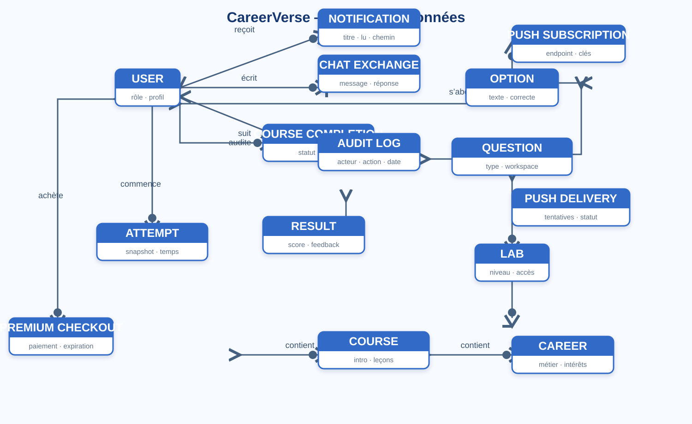

# Rapport de conformité ISO/IEC 25010

## Périmètre

CareerVerse est une plateforme web d'orientation couvrant le catalogue des métiers,
les cours, les laboratoires, la progression, les recommandations, l'administration,
la facturation Premium et les notifications.

Le code est séparé en deux applications :

- Angular/Ionic pour l'interface SPA ;
- Django/Django REST Framework pour l'API, les règles métier et les données.

## Modèle de données



Les relations de `CourseCompletion` et `Attempt` réalisent respectivement des
relations plusieurs-à-plusieurs entre utilisateurs/cours et utilisateurs/labs,
avec des attributs d'association et des contraintes d'unicité.

## Rôles

| Rôle | Cours/labs/questions/options | Comptes | Audit |
|---|---:|---:|---:|
| Étudiant | Lecture/utilisation | Son profil | Aucun |
| Éditeur de contenu | Lecture/CRUD | Aucun | Aucun |
| Administrateur | Lecture/CRUD | CRUD | Lecture |

Les anciens comptes staff sont migrés en administrateur. Les rôles sont portés par
`User.role` et synchronisés avec les indicateurs Django nécessaires à la compatibilité.

## Workflow auditable

Le suivi d'un cours suit la transition :

```text
non démarré -> in_progress -> completed
```

Une transition est persistée atomiquement par utilisateur et cours. La complétion
est idempotente. Chaque démarrage, complétion, modification sensible, connexion,
soumission de lab et opération d'administration crée un événement dans `AuditLog`.

## Règles métier explicites

1. Une adresse email est unique sans distinction de casse.
2. Une transition de cours ne peut être complétée deux fois.
3. Une soumission de lab est protégée contre la répétition.
4. Une réponse est validée contre une copie immuable du lab.
5. Le score est composé à 80 % de l'exactitude et à 20 % du temps.
6. Un lab est réussi à partir de 70/100.
7. L'évaluation finale exige les trois labs gratuits et utilise leur meilleur score.
8. L'accès aux cours et labs Premium exige une date `premium_until` future.
9. Un paiement Stripe doit correspondre au checkout et à l'utilisateur persistés.
10. Les endpoints Push n'acceptent que des fournisseurs HTTPS autorisés.

## Conformité des huit caractéristiques

### 6.1 Aptitude fonctionnelle

- CRUD complet : utilisateurs, carrières, labs, cours, questions et options.
- Tableau de bord filtrable par période et carrière.
- Recherche du catalogue et filtres.
- Workflow cours, rôles, audit, recommandations et administration.
- Preuve : suite Django, tests d'intégration frontend et E2E Playwright.

### 6.2 Efficacité de performance

- Objectif retenu : P95 inférieur à 500 ms à 20 utilisateurs simultanés.
- Exécution Locust : 731 requêtes, zéro échec, P95 global 25 ms, maximum 130 ms.
- Rapports : `backend/reports/performance/`.

### 6.3 Compatibilité

- Tests exécutés dans Google Chrome et Microsoft Edge.
- API JSON consommée par le client Angular et par les intégrations Stripe, Google,
  SMTP et Web Push.
- Tests : `frontend/e2e/` et `frontend/reports/playwright/`.

### 6.4 Facilité d'utilisation

- Parcours d'inscription, recherche, consultation de cours et profil testé.
- FR/EN/AR, RTL arabe, thème clair/sombre, labels de formulaire, navigation
  clavier et états loading/erreur/empty.
- Preuve automatisée : Playwright et vérification des 1 042 traductions.
- Recette et captures finales restent à documenter avec le script de soutenance.

### 6.5 Fiabilité

- Transactions atomiques, verrous `select_for_update`, idempotence et snapshots.
- Queue Web Push avec cinq tentatives et expiration des endpoints invalides.
- Tests d'interruption simulée Stripe/Web Push et de soumission répétée.

### 6.6 Sécurité

- Sessions, CSRF, validation stricte, permissions RBAC, throttling et cookies sécurisés.
- Limites applicatives sur corps et en-têtes, webhook Stripe signé, VAPID validé.
- Bandit : zéro alerte.
- pip-audit : zéro vulnérabilité connue.
- npm audit : zéro vulnérabilité connue.
- DAST applicatif : contrôle accès anonyme, CSRF, payloads d'injection et en-tête
  `Accept` surdimensionné, résultat PASS.

### 6.7 Maintenabilité

- Séparation frontend/pages/services/widgets et backend/API/domain/models/services.
- Types TypeScript vérifiés, migrations versionnées et tests maintenables.
- Couverture backend mesurée à 95 %.
- Rapports : `backend/reports/quality/coverage-html/`.

### 6.8 Portabilité

- PostgreSQL, frontend Nginx, backend Gunicorn et worker Push dans Docker Compose.
- `docker compose config` est validé. Le lancement de conteneurs doit être exécuté
  sur une machine où le démon Docker est disponible.

## Résultats reproductibles

Voir [TEST-EXECUTION.md](TEST-EXECUTION.md) et
[TRACEABILITY.md](TRACEABILITY.md).
